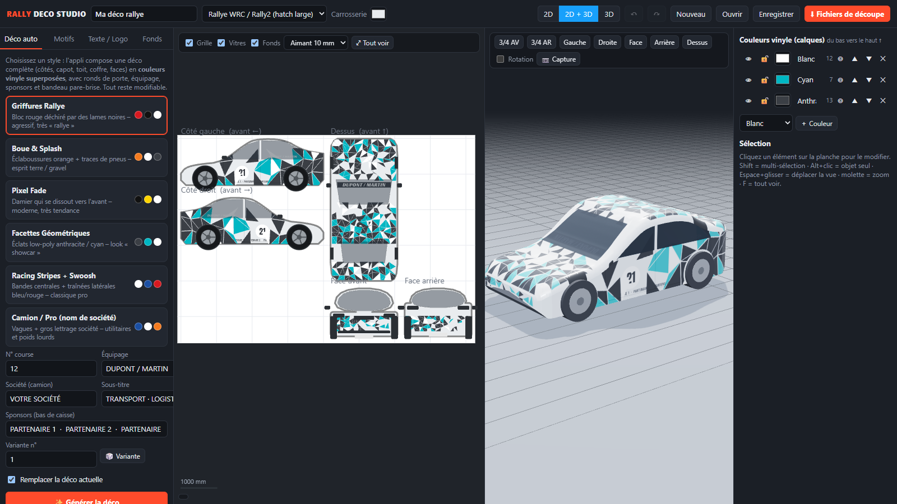

# Rally Deco Studio

Concevoir des **décos vinyle pour voitures de rallye, utilitaires et camions** et sortir des **fichiers prêts à découper** (un fichier par couleur de vinyle), avec aperçu 2D et **vue 3D**.

**Essayer en ligne : https://maxmonneret.github.io/rally-deco-studio/**

Un seul fichier HTML, **sans installation, sans compte, hors-ligne** : ouvrez `dist/RallyDecoStudio.html` dans Chrome / Edge / Firefox.



## Ce que ça fait

| | |
|---|---|
| **Planche 5 vues à l'échelle 1:1 (mm)** | côté gauche, côté droit, dessus, face avant, face arrière – comme vos modèles « 106 » / « Valdenaire ». 5 gabarits intégrés : citadine rallye, WRC/Rally2, pick-up/4x4, utilitaire, camion 7,5 t |
| **Vue 3D temps réel** | la déco est plaquée sur une carrosserie 3D (flancs, toit/capot/coffre, faces). Rotation à la souris, vues prédéfinies, capture JPG |
| **Déco auto « comme un designer »** | 6 styles complets : *Griffures Rallye* (rouge/noir/blanc), *Boue & Splash*, *Pixel Fade*, *Facettes géométriques*, *Racing Stripes + Swoosh*, *Camion / Pro*. Ajoute ronds de porte, n° de course, équipage, sponsors de bas de caisse, bandeau pare-brise. Bouton 🎲 pour une autre variante |
| **Calques = couleurs de vinyle** | superposition de couleurs (ordre bas → haut), visibilité, verrouillage, palette de vinyles usuels |
| **Motifs vectoriels** | griffures, éclaboussures, traces de pneus, flammes, damier dégradé, demi-teintes, facettes low-poly, bandes inclinées, chevrons, lignes de vitesse, swoosh, vagues + formes de base |
| **Texte → contours** | 7 polices sport/techno intégrées (OFL), espacement, inclinaison, contour/liseré automatique |
| **Logos / pub** | import **SVG** (vectoriel) ou **PNG/JPG** (vectorisation par seuil) |
| **Fonds avec échelle** | importez la photo/le plan d'un véhicule, cliquez 2 points de distance connue → échelle réelle |
| **Ajustement carrosserie** | les décos sont coupées aux contours du véhicule et aux passages de roues (option sans vitres) |
| **Export découpe** | par couleur : **PDF**, **.ai** (PDF vectoriel compatible Illustrator), **SVG** ; ZIP complet |
| **Dossier client** | PDF A3 : planche + 4 rendus 3D |

## Fichiers de découpe

* Échelle **1:1**, largeur de page = **largeur du rouleau** (600 mm par défaut, réglable).
* Chaque motif est une **pièce** étiquetée (vue + position) ; les pièces plus larges que le rouleau sont **découpées en bandes** avec recouvrement (12 mm par défaut) et rangées sur le rouleau.
* **Repères de recalage** aux 4 coins, en-tête (projet, couleur, surface, mètres de coupe), option **miroir** (pose à l'envers).
* Trait de coupe en couleur d'accompagnement **`CutContour`** (magenta 100 %) : reconnu par Roland CutStudio / VersaWorks, et à mapper sur le calque de coupe pour Graphtec Studio, Summa GoSign, Flexi…
* Option **réserves** : les couleurs du dessus évident celles du dessous (avec recouvrement réglable) au lieu de la superposition.
* Tableau récapitulatif : pièces, m² utiles, longueur de rouleau, mètres de coupe → utile pour le devis.

> Les `.ai` produits sont des **PDF vectoriels** (format que Illustrator ouvre nativement). Si votre logiciel hésite, utilisez le `.pdf` ou le `.svg`.

Exemples générés : [`exemples/`](exemples/).

## Utilisation rapide

1. Choisissez le véhicule (en haut) → onglet **Déco auto** → un style → **Générer**.
2. Cliquez/déplacez/redimensionnez les éléments sur la planche (poignées, `Maj` = proportions / multi-sélection, `Alt+clic` = objet seul, `Espace`+glisser = déplacer la vue, molette = zoom, `F` = tout voir, flèches = 1 mm / `Maj` 10 mm, `Ctrl+Z/Y`, `Ctrl+D`).
3. Changez les couleurs dans le panneau de droite, ajoutez motifs / texte / logos.
4. **⬇ Fichiers de découpe** → réglez rouleau/marges → ZIP ou fichier par couleur.

La planche est symétrique par défaut (« Miroir G/D » copie un élément sur le côté opposé).

## Développement

```powershell
node build.mjs            # assemble src/ + vendor/ + fonts/ -> dist/RallyDecoStudio.html (+ docs/index.html pour GitHub Pages)
node tools/headless-export.mjs hatch griffures exemples/mon_test   # génère les PDF sans navigateur
```

`src/` : `geom.js` (Clipper : union/intersection/offset, SVG, vectorisation) · `vehicles.js` (gabarits) · `gens.js` (motifs, texte) · `styles.js` (décos auto) · `app.js` (éditeur 2D) · `view3d.js` (three.js) · `export.js`/`pdf.js` (PDF/SVG/ZIP sans dépendance) · `ui.js`.

Bibliothèques incluses : [js-clipper](https://sourceforge.net/projects/jsclipper/) (Boost), [three.js](https://threejs.org) (MIT), [opentype.js](https://opentype.js.org) (MIT). Polices : Bebas Neue, Russo One, Anton, Racing Sans One, Black Ops One, Audiowide, Bungee (SIL Open Font License, Google Fonts).

## Limites connues

* Les gabarits intégrés sont des silhouettes **génériques** (proportions approximatives) : pour un modèle précis, importez votre plan en fond et calibrez l'échelle.
* La 3D est une carrosserie lissée (pas un modèle constructeur) : le pare-brise/lunette utilisent la texture du dessus.
* Non testé sur une vraie découpeuse : vérifiez toujours un petit essai de coupe (échelle, miroir, trait de coupe).

Licence MIT (code). Voir les licences des bibliothèques et polices ci-dessus.
